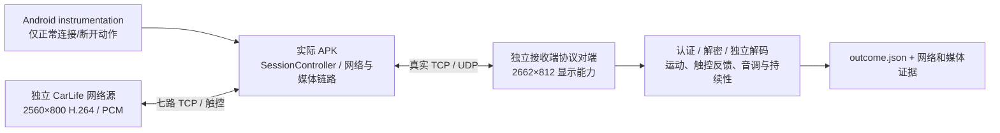

# BMW iD8：网络行为验收与 session10 修复

本实验基于上游 **1.2.38 / `7c55ac0a15a59dae322d16fed8b07dc50f8c3011`**，构建标识为 `bmw-session-10`。本轮再次同步上游，主分支暂无新代码增量。保留上游连接前检查、会话启动闸门、当前 WiFi 接管、appStates、分级 TEARDOWN、vocoderInfo 与能力协商改进，并整合已有实车补丁。

目标是把已有 BMW MGU-93 / iD8 日志和同车可用转换盒的协议证据变成长期回归保障，减少实车试错。验收边界是 **真实 Android APK 的网络输入与网络输出**；仓库只包含独立协议对端、媒体源与判定器，不包含车机固件、UI 或整套 HU 模拟器。

## 本轮修复

| 问题 | 修复后的行为 |
| --- | --- |
| 虚拟 iAP 认证序列与转换盒证据不一致；已建链时忽略新的 DETECT | 按对端 AA06 能力走带空参数的首次证书请求及后续完整证书请求；重新探测重置链路代次、认证与订阅；旧代排队数据及响应失效 |
| 认证静默可能被当成成功 | 只有已发挑战收到非空响应后才发送 AA05；重试耗尽保持未认证 |
| 损坏的 SRP 证明触发 pair-verify、明文降级及 15 分钟跳过配对记忆 | 完整性失败终止本轮；显式旧协议能力才允许明文。删除拒绝记忆和为它补救的失败计数策略，下次连接正常重新认证，已有偏好文件保持不变 |
| 晚到/重复连接邀请拆掉仍然健康的控制会话 | 建链中及已建立的健康会话吸收邀请，不重新配对或拆建媒体；实际失败仍走有界恢复 |
| 实际 CarLife 引擎可发送 INIT → STOP → INIT → PCM 而没有 RESUME | 初始化、非空 PCM 与音乐模块焦点共同证明播放；已知暂停仍生效；通知使用权缺失表示未知而不是暂停 |
| 音频播放/车机收回音频的状态在重连时丢失 | 播放 episode 跨源传输及 AirPlay helper 替换保存；车机 TAKE 抑制同一次播放重新抢占，真正停止后新播放才恢复资格 |
| STOP 或车机 TAKE 与正在发布的音频取权交错 | 在途 claim 及 SETUP/RECORD/编码器启动检查当前意图；已接受但已失效的取权恢复原所有权；重叠 helper 的 claim 分别计数 |
| appStates 更新使资源事务失效后没有重试 | 区分状态失效与车机拒绝，按当前意图重新协调；车机拒绝或 TAKE 不触发抢占循环 |
| 健康退场提前关闭事件读线程 | 保留协议响应直至分级 TEARDOWN 完成，同时停止应用层新工作 |
| 缓存 GOP 回放与实时视频交错 | 缓存回放、实时帧和源重启配置复位共用投递锁；首个 avcC 与 IDR 以及后续参考帧保持顺序，退役仍能关闭阻塞的发送器 |
| 源重连的状态复位晚于新视频读线程 | 在启动新 CarLife 读线程前复位解码状态，避免已经发出新 IDR 后又进入等待、丢掉下一整个 GOP；看门狗仍在握手成功后启动 |
| 音乐与导航并发 PCM 被串接到同一时间线 | 每路独立重采样和有界队列；单一输出时钟逐帧混合，导航时平滑降低音乐音量，停止一路只清理该路 |
| 短暂输入抖动被新队列实现放大成重复预缓冲 | 40ms 预缓冲只用于明确源启动、清理或格式切换；普通队列暂时耗尽后，后续 PCM 在下一输出块恢复，不再次插入启动等待 |
| 切歌 STOP 消耗了仍有效的音乐焦点授权 | 曲间 STOP 保留同一次已授权焦点，后续 INIT/PCM 可继续；PAUSE、明确媒体暂停、焦点释放和车机 TAKE 仍生效，不凭切歌重新抢权 |
| 短暂导航 STOP/INIT 拆建整条音乐流 | 仅保留实际成功激活过的流与授权；初始资源归属不启动空闲音频。授权随当前客户端/车机 TAKE 代次保存，允许合法换流，退役或资源丢失即失效 |
| 已激活视频掩盖新音频尚未 RECORD，或 SETUP 期间源已暂停 | 初始 SETUP/RECORD 前后均检查实时播放意图；准备过的 sender 不等于已激活授权。取消仅退役相应音频，不把暂停当成协议拒绝拆掉视频 |
| 本地视频通道重连绕过有序特征协商 | 所有编码 INIT 共用当前代次的版本/特征 ACK 前提；等待期间合并最新请求，实际发送才消耗首轮状态及去重记忆 |
| 零重传 WLAN 参数被当成已收 ACK | 可靠 WiFi 仍按真实接收窗口和 ACK 限制在途载荷；即时 CSM 回复携带 ACK，无回复时正常单独确认；BT 与 type130 特性保持隔离 |
| 已推流和完整握手混在同一“就绪”概念里 | 分别记录邀请、控制加密、RECORD、iAP 各认证阶段、源特征/编码 ACK、真实首 IDR、实际 PCM 输入和 RTP 输出；记录不能替代 HU 界面或扬声器观测 |
| 接收端声明由它主动发起，却把旧邀请用于后续失败重试 | 每次激活消费一次实际 HTTP 邀请，核对接收端身份、对端/本地地址、已知网络代次和有效期；mDNS 地址发现不再替代 bit37 车机的新邀请，健康重复邀请不留给下一轮 |

session9 的 16 个场景没有覆盖音乐/导航并发和同焦点连续切歌；宽松的逐包 ACK 对端也没有检验零重传下的实际窗口。session10 补充这些网络行为，而不是把更多 App 状态作为通过条件。实车 iAP 重置的确切拒绝原因仍需区分于已确认的流控缺陷；没有证据支持额外发送一个通用“已就绪”命令。

参考 [Hypercar 的可靠 WiFi iAP 实现](https://github.com/fw867/hypercar/blob/694a2dcea66866def2166e8261dec0ddb1153186/app/src/main/java/io/github/hypercar/iap2/WifiIap2Protocol.kt)及同车可用转换盒。前者的 `AD00→AD01(param0=1)` 固件分析补足了工作盒日志未打印的参数尾部；它是应用发现回复，不是通用连接完成通知。协议事实和来源记录在 `provenance.json`，未引入整套车机实现。

缓存 GOP 与实时帧交接问题由本轮网络 E2E 实际发现：APK 日志显示缓存线程发送配置后，实时线程先发出第 1 个 P 帧，缓存 IDR 反而成为第 2 帧。接收端独立解析并拒绝了这种新解码器启动顺序。修复后保留原来的 IDR-first 判定，没有放宽判定器。后续源重连验收又发现新 IDR 已送出、握手返回后才复位状态的竞争；将准备阶段前移后，仍按原来的 15 fps 下限验收。

## 独立判定边界



`tools/e2e/id8/fixtures/contract.json` 是可审阅的接收端契约；`provenance.json` 区分实车观测、转换盒证据及受控实验状态。对端不导入应用协议解析器，不用应用 ready 标志、日志文案或内部计数宣布成功。

主要判据：

- 独立执行 SRP-6a、X25519/Ed25519 配对验证及控制/事件通道加密，检查 iAP 帧边界、认证请求与最终完成。
- 允许实车已经接受的 **RECORD 早于 iAP 完成** 顺序；最终分别要求媒体与 iAP 就绪。
- 在实际网络上观察资源所有权、媒体停止、恢复与重连；屏幕所有权和音频所有权分别验收。
- 解密 H.264，要求配置后由 IDR 起播、实际可见尺寸为 **2560×800**，并解码运动及触控导致的红/绿状态变化。车机能力中的 **2662×812** 是独立画布参数。
- 解密并解码音频，检查非静音 440 Hz 音乐、880 Hz 导航、RTP 时钟和 nonce；同时检查真实解码样本时长覆盖播放时间，防止低速送包却被误判有声。
- 基线在媒体启动后持续观察 **60 秒**，覆盖已有 10–20 秒失效窗口；20 fps 独立源至少达到 15 fps 实际解码输出，同时检查媒体、保活、反馈及 UDP timing 响应，排除 1 fps 占位画面冒充恢复。

## 默认验收矩阵

| 场景 | 网络上的最终效果 |
| --- | --- |
| `baseline` | 认证、空闲不抢收音机、HID 往返、解码画面与音乐、60 秒持续播放 |
| `late-invite`、`duplicate-invite` | 健康控制连接和已解码媒体保持，邀请不引起拆建 |
| `screen-yield-return` | 交还屏幕后停止视频、音乐继续；requestUI 后画面恢复 |
| `radio-yield-return` | 收音机收回音频后，重复 INIT/焦点以及源和整个 AirPlay 重连仍保持让权；新播放恢复 |
| `navigation` | 导航临时借用音频，解码 880 Hz；播报结束归还车机 |
| `peer-reset` | 接收端整条连接与源 TCP 同时重建，原播放 episode 下恢复实际媒体 |
| `teardown-reconnect` | 正常断开在网络上完成媒体及会话 TEARDOWN，再连接恢复媒体 |
| `network-drop-reconnect` | Android WiFi 开关与整条接收端 TCP 断开组合，恢复后重新认证、解码 |
| `source-reconnect` | 同一次播放连续重建三次 CarLife 七路 TCP，健康 AirPlay 保持；每次 8 秒内解码出新画面标记及 660/550/770 Hz 音频，再检查持续性，旧缓冲不能冒充恢复 |
| `stale-audio-take` | 延迟取权响应期间真实源 STOP，响应放行后归还资源且不激活音频 |
| `car-take-during-claim` | 首次媒体取权在途时车机 TAKE 生效，旧响应和同次播放不抢回音频；新播放可恢复 |
| `concurrent-audio` | 同时输入不同采样率/声道的音乐与导航；每 100ms 解码窗口内同时存在两种音调，输出样本时长等于真实播放时间；连续三次导航 STOP/INIT 不打断音乐 |
| `track-transition` | 同一音乐焦点下连续三次 STOP→INIT→PCM / STOP→PCM，解码出不同新音调；跨切歌导航仍可听，控制连接保持 |
| `iap-window` | 接收窗口 5、零重传，延迟 150ms 累积 ACK；网络入口统计在途载荷，四次应用发现请求的回复须在窗口限制内全部完成 |
| `source-start-order` | 初始视频 TCP 断开、特征 ACK 延迟两秒；源仅接受特征确认后的新 INIT，八秒内必须有真实解码画面，避免靠重新配对恢复 |
| `audio-record-delay` | 新音频流 RECORD 回复延迟一秒；此前已激活视频不能替代新音频激活，任何提前 RTP 都失败 |
| `explicit-source-intent` | PAUSE/焦点释放后残余 PCM 不得恢复音乐，导航继续；永久手机音频归属下停止/恢复导航须保留原流及 SETUP/RECORD 历史；车机 TAKE 后 STOP/INIT/PCM 保持让权，明确 RESUME 无需新焦点即可恢复新音调 |
| `initial-source-cancel` | 真实源先播放、接收端初始允许手机音频；首个音频 SETUP 响应在途时源 PAUSE 且继续残余 PCM。旧准备流须在网络上退役、不 RECORD/发包；明确 RESUME 后同一控制会话恢复实际音调 |
| `negative-bad-auth` | 只破坏 SRP 服务端证明，后续 pair-verify/SETUP 即失败；后面的场景保留 App 数据继续认证，检查拒绝不会污染下一次连接 |
| `negative-iap-auth` | 不回挑战响应，观察至重试耗尽之后；任何无响应的 AA05 都失败 |
| `negative-no-audio`、`negative-no-video` | 已认证媒体在接收入口丢失后，判定器必须拒绝缺少实际解码结果 |

默认共 23 个场景。负向对照必须同时证明故障已经施加、指定效果被判定器拒绝；普通超时、解析异常或环境故障不能冒充负向通过。并发验收除 100ms 频谱外，还逐 10ms 拟合独立音调，排除同一窗口内交替拼接两种声音；导航 STOP/INIT 的过渡区间本身也必须有音乐。切歌必须保持实际音频 streamConnectionID、SETUP/RECORD 生命周期及 RTP 时钟。

## 运行

需要 JDK 17、项目所需 Android SDK/build-tools、ADB，以及一个**专用、已启动的 Android API 31+ emulator**。当前离车环境使用 API 34 x86_64。运行器拒绝物理设备，避免改动日用手机/平板的配置。Android emulator 只运行真实 App，不承担 HU 角色。

```sh
python3 -m venv /tmp/carptocarl-id8-venv
/tmp/carptocarl-id8-venv/bin/pip install -r tools/e2e/requirements.txt
export JAVA_HOME=/path/to/jdk-17
export ANDROID_HOME=/path/to/android-sdk
export ANDROID_SDK_ROOT="$ANDROID_HOME"
export PATH="$JAVA_HOME/bin:$ANDROID_HOME/platform-tools:$PATH"

/tmp/carptocarl-id8-venv/bin/python tools/e2e/run_id8.py \
  --serial emulator-5580 \
  --artifacts /tmp/carptocarl-id8-run-unique
```

默认构建并安装 debug APK 和独立 instrumentation APK，然后执行完整矩阵。已经构建的本地迭代可加 `--no-build`；定位单个失败可用 `--scenarios source-reconnect` 等。交付门禁使用完整默认矩阵。

`--artifacts` 必须是新目录。默认地址针对本机 Android emulator：App 从 `10.0.2.2` 访问接收端，CarLife 源通过七个 ADB reverse 端口访问；timing 使用 emulator 的 UDP 重定向。远程运行可通过 `--help` 查看地址参数。

如果 Android runtime 本身崩溃，先修复运行环境再执行验收。当前工作站的 SwiftShader 启动崩溃，NVIDIA host 渲染器又在跨场景退场时触发 gfxstream 原生崩溃；改用 `__GLX_VENDOR_LIBRARY_NAME=mesa LIBGL_ALWAYS_SOFTWARE=1` 配合 `-gpu host -feature -Vulkan`，实际使用 Mesa llvmpipe 软件 OpenGL 后完成整轮场景运行。环境崩溃与 App 网络判定分别留证。

## 证据与通过条件

总结果 `outcome.json` 的 `passed` 必须为 `true`，每个场景也必须通过。每次运行保存：

- 实际 APK、副本输入、fixture 与脚本哈希、依赖版本、命令记录及 `rerun.sh`。
- 每场景接收端输入 plist、网络事件、源视频/PCM、收到的 H.264/WAV、解码截图及判定结果。
- `decoded-audio-quality.json` 保存独立解码的 100ms 窗口 RMS、各音调能量比例、削顶比例和采样时长，支撑并发声音与连续切歌判定。
- App logcat 作为定位证据；它不参与成功判定。
- 清理结果及任何清理异常；各场景释放 TCP/UDP、ADB reverse/forward 和 timing 重定向，恢复 WiFi。

失败运行应保留；修复后写入新目录。重跑脚本自动使用新证据目录，不覆盖原失败输入。实车日志、配对身份和密钥保存在工作区私有 artifacts 中，不提交仓库或直接贴入公开 Issue。

## 实车边界与最少补充验收

这个门禁保障模型覆盖的网络行为，并直接运行 App 的生产连接、资源和媒体链路。物理蓝牙、车机热点关联、BMW 固件 UI 和扬声器仍由实车证据补齐。合成 iAP 证书/签名验证顺序与非空响应条件，不代表 Apple MFi 信任链校验；当前 App 未对该签名做密码学验证。

独立网络运行器使用正常测试台直连，覆盖实际 ctrl HTTP 监听、健康邀请处理和 AirPlay/媒体链路；它绕过真实蓝牙及 mDNS 激活决策。新增单次邀请策略另有 15 项纯策略回归，覆盖身份/网络切换、早到邀请、过期和延迟回调；这不冒充已验证真实车机发现/邀请整条链路。真实车机 pending 的最终 UI 判断仍需一次实车日志与观察闭环。

每个候选先通过完整网络矩阵与真机编码/加密音频离车探针，再安排一次合并实车流程：保留旧配对连接 → 音乐连续播放并自动切下一首 → 导航与音乐并发 → 返回车机桌面再进入 CarPlay → 切收音机再主动播放 → 一次正常断开重连。记录每步时间和听到的声音，统一导出日志。任何断开即保留现场证据，避免连续反复重试让车机进入更差状态。

LXbox 延续已选的最小应用排除配置，本轮不改其配置。上游 Issue/PR 在批准前只保留本地草稿；公开内容使用脱敏证据，并区分网络验收通过与真实车机确认。
